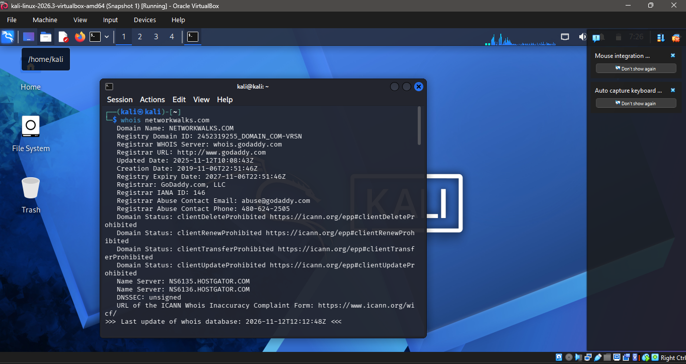
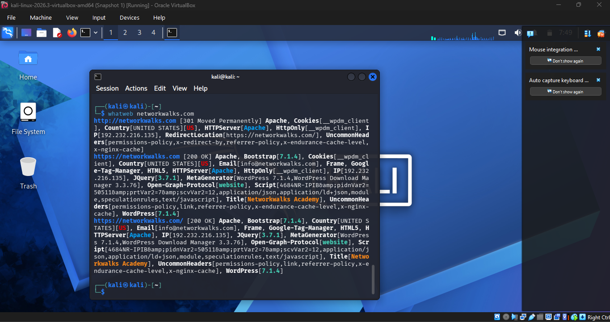
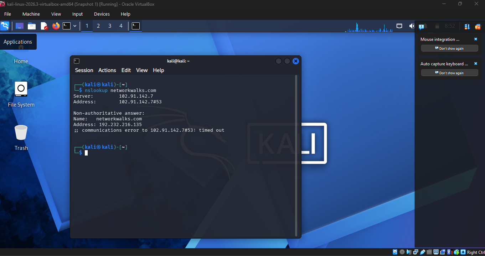
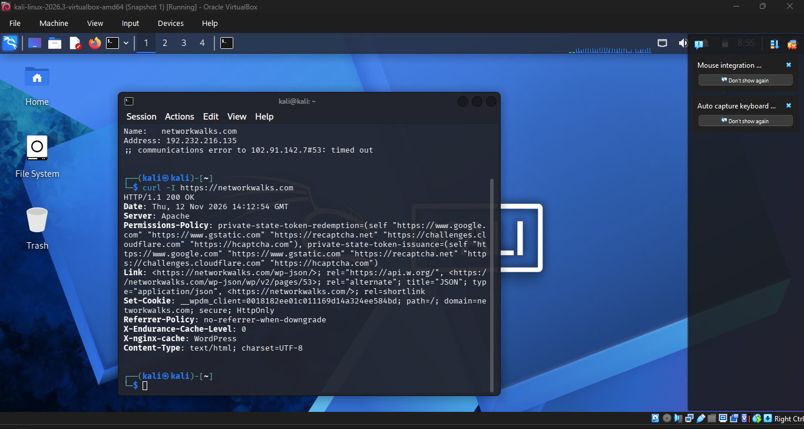
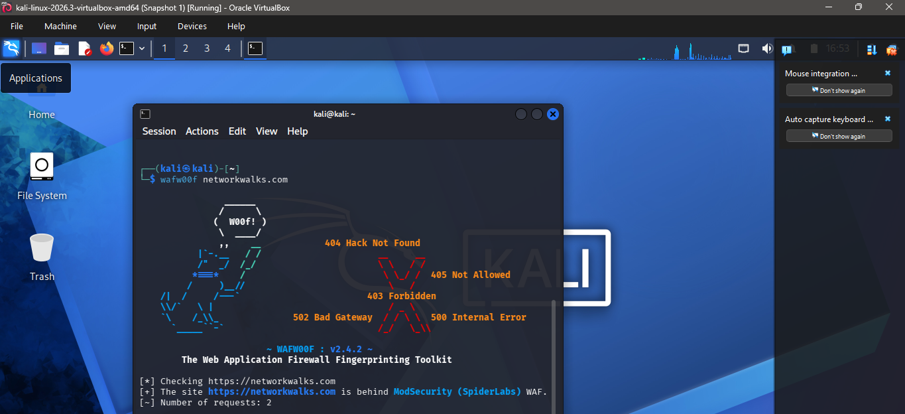
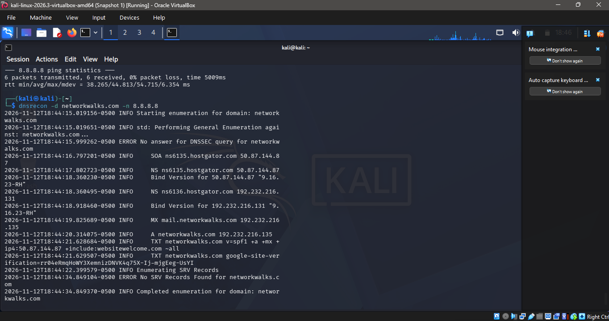
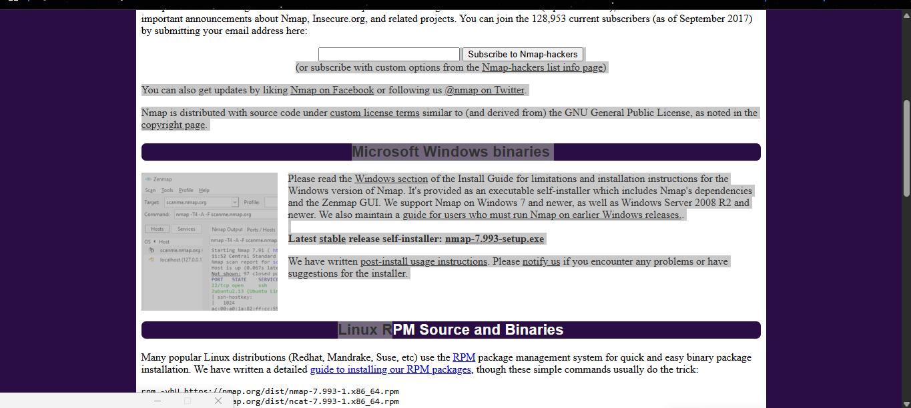
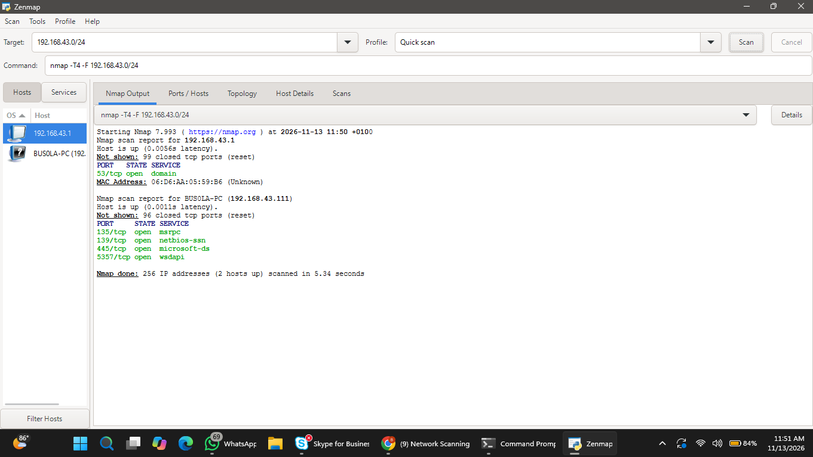
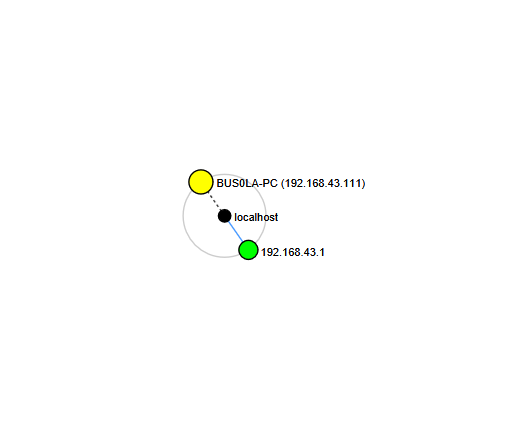

# Penetration Testing Report: Footprinting & Network Scanning

**Week 2 Practical | Cybersecurity & Ethical Hacking | Networkwalks**

| Project detail | Information |
|---|---|
| **Program** | Networkwalks Cybersecurity Internship |
| **Batch** | B084 |
| **Report date** | 13 November 2026 |
| **Modules** | W2-PM1: Multiple Kali Tools; W2-PM5: Zenmap Scanning |
| **Completed phases** | Phase 1: Reconnaissance & Footprinting; Phase 2: Scanning & Network Discovery |
| **Other phases** | Phases 3–5: In progress |
| **Environment** | Kali Linux and Windows |

## Project Overview

This repository documents my Week 2 practical exercises in **reconnaissance, footprinting, and network scanning**. I used Kali Linux tools to collect publicly accessible technical information about an authorized web target, then used **Zenmap (the Nmap GUI)** to identify hosts and services on my own local network.

The exercises demonstrate how initial reconnaissance and network discovery help security professionals understand a system's exposed attack surface **before any vulnerability validation or exploitation**.

> **Authorization:** The activities described in this report were performed against systems for which written authorization was reported, or against devices on an owned local network. Do not run these commands against systems without permission.

## Objectives

- Collect publicly available domain and DNS information.
- Identify exposed web technologies and HTTP response headers.
- Determine whether a web application firewall (WAF) is detectable.
- Discover active devices on an authorized local network.
- Review the resulting IP addresses, MAC addresses, and network topology.
- Document observations, potential risks, and recommended defensive measures.

## Tools and Their Purposes

| Tool | Purpose |
|---|---|
| **WHOIS** | Look up domain registration and name-server information. |
| **WhatWeb** | Fingerprint web technologies and applications. |
| **nslookup** | Resolve domain names to IP addresses. |
| **curl** | Inspect HTTP response headers. |
| **wafw00f** | Identify potentially deployed WAF technology. |
| **DNSRecon** | Enumerate DNS records and related information. |
| **Zenmap / Nmap** | Discover devices and inspect network services. |
| **Windows Command Prompt** | Inspect the local network configuration. |

## Methodology

### Phase 1: Footprinting and Reconnaissance

**Target:** `networkwalks.com` (the authorized training target named in the report).

#### 1. WHOIS: Domain registration lookup

```bash
whois networkwalks.com
```

**Observation:** Publicly available domain registration and name-server information was collected.

#### 2. WhatWeb: Technology fingerprinting

```bash
whatweb networkwalks.com
```

**Observation:** WhatWeb reported technologies including Apache, WordPress `7.1.4`, and WP Download Manager `3.3.76`. These are tool-reported fingerprints, not independently verified vulnerabilities.

#### 3. nslookup: DNS resolution

```bash
nslookup networkwalks.com
```

**Observation:** The domain resolved to `192.232.216.135` at the time of the exercise.

#### 4. curl: HTTP header inspection

```bash
curl -I https://networkwalks.com
```

**Observation:** HTTP response headers provided web-server information and referenced the WordPress REST API endpoint `/wp-json/`.

#### 5. wafw00f: WAF identification

```bash
wafw00f networkwalks.com
```

**Observation:** The tool identified **ModSecurity (SpiderLabs)** as a likely WAF.

#### 6. DNSRecon: DNS enumeration

```bash
dnsrecon -d networkwalks.com -n 8.8.8.8
```

**Observation:** The output included DNS infrastructure information such as name servers, mail records, and TXT/SPF-related records.

### Phase 2: Local Network Discovery with Zenmap

**Target:** My own local network, `192.168.43.0/24`.

First, I checked my local addressing information in Windows:

```cmd
ipconfig
```

I then used Zenmap to scan the local subnet. The captured evidence shows a **Quick Scan**, which executed:

```bash
nmap -T4 -F 192.168.43.0/24
```

**Observed results:**

| Host | Observed status | Example services shown in the scan |
|---|---|---|
| `192.168.43.1` | Up | TCP 53 (`domain`) |
| `192.168.43.111` (`BUSOLA-PC`) | Up | TCP 135, 139, 445, and 5357 |

The captured Zenmap output reported **2 hosts up** in the `/24` subnet. The exercise also included reviewing MAC-address information and generating a visual network topology.

> Open ports and discoverable hosts are **not, by themselves, proof of a security vulnerability**. The scan was used for inventory and initial assessment.

## Observations and Potential Risks

The following ratings reproduce the report's *preliminary risk observations*. They do **not** represent validated security findings.

| # | Observation | Potential impact | Reported risk |
|---|---|---|---|
| 1 | Web technology and version information is detectable | Supports technology fingerprinting and targeted security review | Medium |
| 2 | The website's IP address is discoverable | Reveals the location of the web service | Low |
| 3 | HTTP headers and REST API references are exposed | Supplies additional information for enumeration | Low |
| 4 | WAF technology can be fingerprinted | Reveals part of the defensive technology stack | Low |
| 5 | DNS infrastructure information is publicly visible | Helps map the organization's internet-facing infrastructure | Medium |
| 6 | Multiple hosts are discoverable on the local network | Highlights the need for device inventory and review of unexpected hosts | Medium |

**Important:** No exploitation or vulnerability validation was performed in these modules. A public IP address, DNS record, server header, or identified software version is not automatically a vulnerability.

## Security Recommendations

1. **Review technology disclosures:** Assess whether unnecessary CMS, plugin, and server details are publicly exposed.
2. **Maintain software updates:** Keep the CMS, plugins, servers, and related components patched.
3. **Inspect HTTP headers:** Remove unnecessary disclosures and review security header configuration.
4. **Audit DNS records:** Check public records periodically for stale or unnecessary entries.
5. **Maintain WAF coverage:** Properly configure, tune, and monitor the WAF.
6. **Perform authorized asset discovery:** Identify active devices and services on networks you administer.
7. **Investigate unfamiliar hosts:** Verify whether discovered devices are approved and expected.
8. **Keep network documentation current:** Maintain accurate network inventories and topology diagrams.
9. **Retain written authorization:** Confirm scope and permission before conducting security assessments.

## Evidence and Screenshots

The following screenshots were extracted from the original practical report.

<details>
<summary><strong>Reconnaissance evidence (WHOIS, WhatWeb, nslookup, curl, wafw00f, DNSRecon)</strong></summary>

**WHOIS**



**WhatWeb**



**nslookup**



**HTTP headers**



**WAF identification**



**DNSRecon**



</details>

<details>
<summary><strong>Network scanning evidence (Zenmap and topology)</strong></summary>

**Zenmap installation/reference**



**Zenmap scan results**



**Network topology**



</details>

## Learning Outcomes

Through this practical, I developed hands-on familiarity with **OSINT-style domain reconnaissance, web technology fingerprinting, DNS enumeration, HTTP header inspection, WAF discovery, local host discovery, and network topology documentation**.

The exercise also reinforced the distinction between an **observation**, a **potential security risk**, and a **confirmed vulnerability**.

## Full Report

[View the complete Penetration Testing Report (PDF)](penetration-testing-report.pdf)

## Responsible Use

This repository is for **education and authorized security research only**. Obtain explicit authorization, observe the approved scope, and comply with applicable laws and organizational policies before testing any system.

---

**Report author credited in the PDF:** [Busola Etim](https://www.linkedin.com/in/busola-etim-2427062ab/)  
**Program:** Networkwalks Cybersecurity | **Week:** 02
